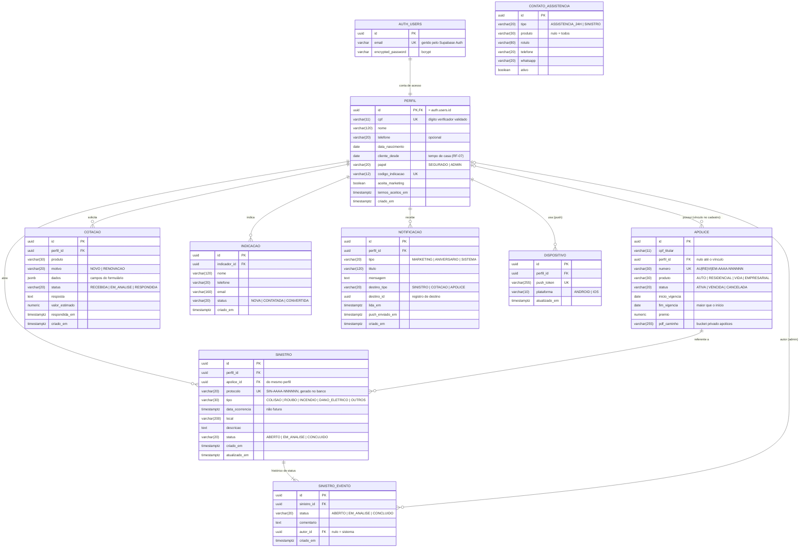

# Banco de dados

Modelo do banco do App do Segurado (PostgreSQL no Supabase). Tudo aqui foi conferido contra as
migrations em `supabase/migrations/` aplicadas num `supabase db reset`: se uma migration nova
mudar tabela ou coluna, este arquivo e o `der.mmd` mudam no mesmo PR.

- Imagem para slides e documentos: [`der.png`](der.png) (alta resolução) ou [`der.svg`](der.svg).
- Fonte do diagrama: [`der.mmd`](der.mmd) (Mermaid). Para regerar as imagens:
  `npx @mermaid-js/mermaid-cli -i docs/der.mmd -o docs/der.png -s 2 -b white`.

## Diagrama entidade-relacionamento

Legenda: `PK` chave primária, `FK` chave estrangeira, `UK` valor único. `||` exatamente um,
`|o` zero ou um, `o{` zero ou muitos, `|{` um ou muitos.

## Relacionamentos

| De | Para | Cardinalidade | Ao apagar o pai |
|---|---|---|---|
| `perfil.id` | `auth.users.id` | 1 : 1 | apaga o perfil (CASCADE) |
| `apolice.perfil_id` | `perfil.id` | perfil 0..1 : N apólices | apólice fica sem dono (SET NULL) |
| `sinistro.perfil_id` | `perfil.id` | 1 : N | CASCADE |
| `sinistro.apolice_id` | `apolice.id` | 1 : N | bloqueia (RESTRICT): apólice com sinistro não some |
| `sinistro_evento.sinistro_id` | `sinistro.id` | 1 : N (ao menos o evento ABERTO) | CASCADE |
| `sinistro_evento.autor_id` | `perfil.id` | 0..1 : N | SET NULL (evento do sistema fica com autor nulo) |
| `cotacao.perfil_id` | `perfil.id` | 1 : N | CASCADE |
| `indicacao.indicador_id` | `perfil.id` | 1 : N | CASCADE |
| `notificacao.perfil_id` | `perfil.id` | 1 : N | CASCADE |
| `dispositivo.perfil_id` | `perfil.id` | 1 : N | CASCADE |

`contato_assistencia` não se liga a ninguém: é cadastro da corretora, filtrado por `produto`.

## Regras que o próprio banco garante

Não dependem da API: valem para qualquer cliente que escreva no banco.

- **Domínios com `CHECK`**: todo `status`, `tipo`, `produto`, `papel`, `motivo` e `plataforma`
  só aceita os valores do diagrama.
- **CPF**: `perfil.cpf` passa pela função `cpf_valido()` (dois dígitos verificadores, rejeita
  11 dígitos iguais).
- **Número da apólice**: formato `PP-AAAA-NNNNNN`, e o prefixo tem que bater com o produto
  (`AU` = AUTO, `RE` = RESIDENCIAL, `VI` = VIDA, `EM` = EMPRESARIAL).
- **Vigência**: `fim_vigencia > inicio_vigencia`.
- **Protocolo de sinistro**: gerado por trigger com sequência, `SIN-AAAA-NNNNNN`.
- **Sinistro só de apólice própria**: trigger recusa sinistro cuja apólice é de outro perfil.
- **Ocorrência não futura**: `data_ocorrencia <= now()`.
- **`atualizado_em`** do sinistro é atualizado por trigger em todo UPDATE.
- **Destino da notificação**: `destino_tipo` e `destino_id` são nulos juntos ou preenchidos juntos.

## Segurança

- **RLS ligado em todas as tabelas, sem nenhuma policy.** Com a chave `anon` ou `authenticated`
  toda consulta volta vazia; só a API, com a `service_role`, lê e escreve. O isolamento entre
  usuários é feito na API, filtrando por `perfil_id` (registro de outro usuário responde 404).
- **Senhas** ficam só em `auth.users`, com bcrypt, sob gestão do Supabase Auth. Nenhuma tabela
  da aplicação guarda senha.
- **PDFs das apólices** ficam no bucket privado `apolices` do Storage; o app recebe uma URL
  assinada que vale 60 segundos (`GET /apolices/{id}/pdf`).

## Dados de teste

`supabase/seed.sql` roda em todo `supabase db reset`: 5 segurados e 1 administrador (senha
`Senha@123`, lista no README), apólices com PDF, contatos, sinistros com histórico, cotações,
indicações e notificações. O João faz aniversário sempre na data do reset, para demonstrar o RF-08.
